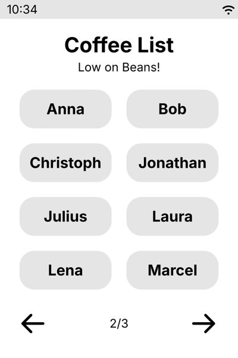
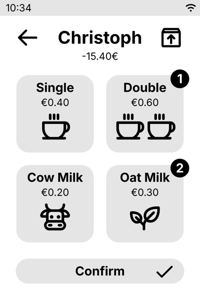
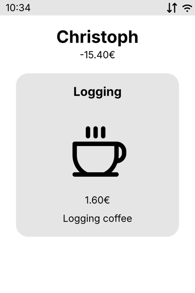
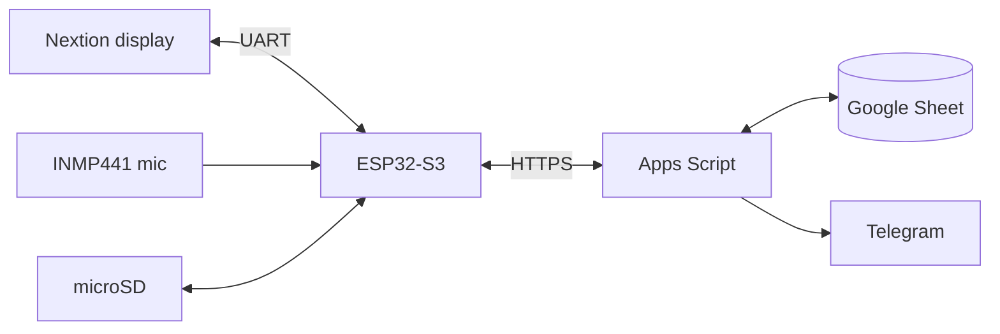

# Coffee Tracker

A touchscreen tally sheet for a shared office coffee machine. Tap your name, pick your coffee, done. Balances, stock and payments live in a Google Sheet, so there's no server to run.

  
  
  

## Features

- Log single or double espresso, plus cow or oat milk, per person
- Track restocks: whoever buys beans or milk gets credited
- Pay by PayPal QR code once your balance drops below a threshold
- Undo the last action straight from the confirmation screen
- Keep working offline: entries queue on the SD card and sync later
- Get Telegram alerts for payments and a daily low-stock report
- Optionally wake the screen when the grinder starts (microphone)

## How it works

The display only shows screens and reports taps. The ESP32 handles navigation, caching and offline mode. An Apps Script web app does the bookkeeping in a Google Sheet that you can also edit by hand.

## Hardware

| Part | Model |
| --- | --- |
| Microcontroller | ESP32-S3 DevKitC-1 |
| Display | Nextion NX4832K035 (3.5″, 320×480) |
| Storage | microSD module (SPI) |
| Microphone (optional) | INMP441 I2S |
| Case | 3D printed, see [`case/`](case/) |

The case is designed in FreeCAD (`case.FCStd`), with STEP exports for both halves.

## Setup

1. **Backend**: create a Google Sheet, paste [`backend/backend.gs`](backend/backend.gs) into Apps Script, run `initializeSheets()` and deploy it as a web app. See [docs/backend.md](docs/backend.md).
2. **Firmware**: copy `esp32/include/config.example.h` to `config.h`, then add your WiFi details and the web app URL. Flash with PlatformIO (`pio run -t upload`). See [docs/firmware.md](docs/firmware.md).
3. **Display**: open [`nextion/coffee-tracker.HMI`](nextion/coffee-tracker.HMI) in Nextion Editor, compile and upload. See [docs/display.md](docs/display.md).

Users, prices and stock thresholds are set in the sheet; the device loads them at boot.

## Repository

| Folder | Contents |
| --- | --- |
| `backend/` | Apps Script backend and a cURL test script |
| `esp32/` | PlatformIO firmware |
| `nextion/` | Nextion Editor project and image assets |
| `audio/` | Notebook and tools for grinder detection, sample recordings |
| `case/` | FreeCAD enclosure and STEP exports |
| `docs/` | [Backend API](docs/backend.md) · [Firmware](docs/firmware.md) · [Display](docs/display.md) · [Grinder wake](docs/audio.md) |

## License

[MIT](LICENSE)
