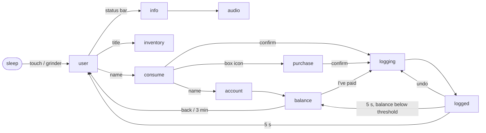

# Display

The UI runs on a Nextion NX4832K035 (3.5″, 320×480, portrait). The project file is [`nextion/coffee-tracker.HMI`](../nextion/coffee-tracker.HMI), and the source images are in [`nextion/media/`](../nextion/media).

To flash: open the HMI in [Nextion Editor](https://nextion.tech/nextion-editor/), compile it, and upload over USB-TTL or copy the `.tft` to a microSD card for the display.

## How the display and ESP32 split the work

The Nextion is close to a dumb terminal. Buttons send a command string to the ESP32 with `prints`, and the ESP32 sets texts and visibility and switches pages. On every page switch the ESP32 switches first (so the screen responds immediately), fills in what it already knows, then fetches anything that's missing while the backend icon blinks.

A few things are handled entirely in the HMI:

- badge counters on the consume and purchase pages (tap to count up, wraps around, resets on page load)
- enabling the confirm button once any badge is non-zero
- coloring the balance red when it starts with `-`
- the clock, which reads the Nextion RTC every second
- the blinking backend icon. The ESP32 enables or disables a `backend` timer on each page

Every text field the ESP32 writes starts out empty in the HMI, and every element it toggles starts hidden (`vis=0`). This keeps stale values from flashing up during page switches.

## Pages

| # | Page | Purpose | Sleep after |
| --- | --- | --- | --- |
| 0 | `boot` | Startup status | – |
| 1 | `user` | User grid, 8 per page | 120 s |
| 2 | `consume` | Pick coffee and milk | 120 s |
| 3 | `purchase` | Log a restock (treasurer only) | 120 s |
| 4 | `logging` | Shown while a request is in flight | never |
| 5 | `logged` | Done screen with undo, auto-advances after 5 s | 30 s |
| 6 | `account` | Last 10 transaction rows | 120 s |
| 7 | `balance` | PayPal QR code, auto-returns after 3 min | 180 s |
| 8 | `inventory` | Stock levels | 60 s |
| 9 | `info` | WiFi/backend/SD status, manual sync | 60 s |
| 10 | `audio` | Grinder detection diagnostics | never |



## Objects set by the ESP32

The status bar on every page except `boot` has `status.txt` ("Offline – logging locally" or empty), `wifi_icon` and `backend_icon`.

| Page | Objects |
| --- | --- |
| `boot` | `status.txt`, `version.txt` |
| `user` | `username0`–`username7` (txt + vis), `page.txt` ("1/2"), `nav_prev`, `nav_next`, `inventory.txt` ("Low on Beans!") |
| `consume` | `username`, `userbalance`, `single_price`, `double_price`, `cow_price`, `oat_price`, `vis purchase` (treasurer only) |
| `purchase` | `username`, `userbalance`, `beans_price`, `water_price`, `cow_price`, `oat_price` |
| `logging` | `username`, `userbalance`, `title`, `amount`, `subtitle`, `action.val` (0 consume, 1 purchase, 2 settle, 3 undo; picks the icon) |
| `logged` | `username`, `userbalance`, `amount`, `subtitle`, `vis undo_btn` (hidden after an undo), flow timer `tm0` |
| `account` | `username`, `userbalance`, `row0`–`row9` × `_date` / `_action` / `_item` / `_qty`; `nav_prev` and `balance` hidden while loading |
| `balance` | `username`, `userbalance`, `qr.txt` (`https://paypal.me/<name>/<amount>`), `paypal_url`, flow timer `tm0` |
| `inventory` | `beans_qty`, `water_qty`, `cow_qty`, `oat_qty`. The suffix ` !` means low and ` !!` means critical; `nav_prev` hidden while loading |
| `info` | `wifi_status`, `backend_status`, `last_sync`, `sd_status`, `firmware`; `sync` hidden while syncing |
| `audio` | `threshold_val.txt`, waveform `id 9` (ch 0 threshold, ch 1 live correlation) |

## Commands (display → ESP32)

Commands are sent as newline-terminated ASCII. Badge counts in the confirm commands are raw bytes (`chr(n.val)`), so a count of zero arrives as `0x00`.

```
PAGE:USER:SELECT:<user>
PAGE:USER:INVENTORY
PAGE:USER:INFO
PAGE:USER:NAV:<next|prev>

PAGE:CONSUME:CONFIRM:<user>,<single>,<double>,<cow>,<oat>
PAGE:CONSUME:ACCOUNT:<user>
PAGE:CONSUME:PURCHASE:<user>
PAGE:CONSUME:BACK

PAGE:PURCHASE:CONFIRM:<user>,<beans>,<water>,<cow>,<oat>
PAGE:PURCHASE:BACK

PAGE:LOGGED:UNDO
PAGE:LOGGED:BACK
PAGE:LOGGED:TIMEOUT

PAGE:BALANCE:PAYPAL:<user>
PAGE:BALANCE:BACK
PAGE:BALANCE:TIMEOUT

PAGE:ACCOUNT:BALANCE:<user>
PAGE:ACCOUNT:BACK

PAGE:INVENTORY:BACK

PAGE:INFO:SYNC
PAGE:INFO:AUDIO
PAGE:INFO:BACK

PAGE:AUDIO:RECORD
PAGE:AUDIO:XCORR:<+|->
PAGE:AUDIO:BACK
```

The display also sends Nextion's built-in events `0x86` (entered sleep) and `0x87` (woke on touch).

Consume badges wrap at single 1, double 2 and milk 4. Purchase badges wrap at 9.
